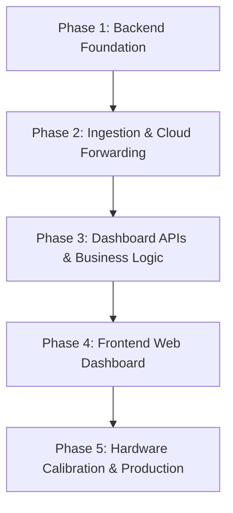

# Project Roadmap

The implementation is divided into five sequential phases:

## Phase Breakdown
- **[Phase 1: Backend Foundation](phases/PHASE_01.md)**: Scaffolding, SQLite models, schemas, and API skeleton.
- **[Phase 2: Ingestion & Cloud Forwarding](phases/PHASE_02.md)**: ThingsBoard webhook connection, tunnel setup, and end-to-end ingestion verification.
- **[Phase 3: Dashboard APIs & Business Logic](phases/PHASE_03.md)**: Advanced mix profile endpoints, background disconnect monitors, alert management.
- **[Phase 4: Frontend Web Dashboard](phases/PHASE_04.md)**: Single-page or multi-page dashboard displaying live temperatures, Nurse-Saul maturity progress bar, and history charts.
- **[Phase 5: Hardware Calibration & Production](phases/PHASE_05.md)**: Physical sensor validation, firmware production build, and compressive break test calibration.
